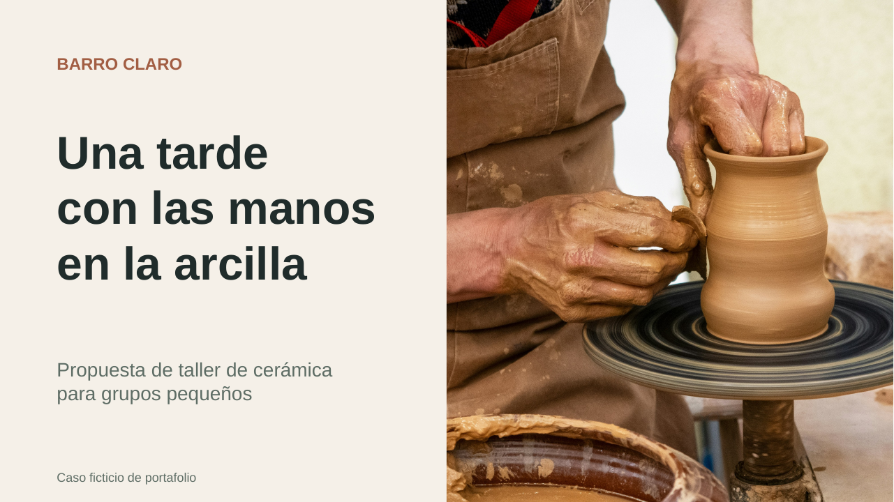

# Presentaciones en español

Una muestra de organización de contenido y diseño de presentaciones editables.

[Ver la presentación en PDF](muestra.pdf)

## La muestra

Seis diapositivas para explicar una propuesta de taller de cerámica: portada, propuesta de experiencia, agenda, comparación de formatos y un escenario de piloto.

**Barro Claro es un caso ficticio de portafolio.** Sus tiempos, cupos y objetivos son ilustrativos. La muestra no corresponde a un cliente ni acredita ventas o reservas reales.

El archivo de trabajo conserva el texto, la tabla y el gráfico como elementos editables. El PDF permite revisar la presentación terminada.

## Un encargo de alcance claro

El rediseño parte del contenido que aporta el cliente. Antes de acordar una entrega se revisan el archivo, el objetivo, la audiencia, el número de diapositivas, el plazo y las revisiones incluidas.

## Fotografía

Fotografía ilustrativa de Javier Balseiro en [Unsplash](https://unsplash.com/photos/hands-shaping-clay-on-a-pottery-wheel-Y8QTLw6AphU), utilizada bajo la [licencia de Unsplash](https://unsplash.com/license). La fotografía no muestra el taller ficticio.
